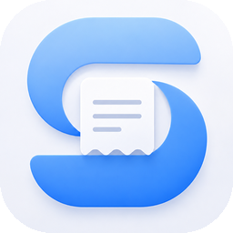

# SIMHub ダウンロード

[English](README.md) · [Русский](README.ru.md)

SIMHub は、iPhone、iPad、Mac、Android で物理 SIM と eSIM を管理するアプリです。対応リーダーを接続すると、取り外し可能な eSIM カード上のプロファイルを管理し、そのカードで Wi-Fi 通話、SMS、音声通話を利用できます。

> SIMHub は審査への異議申立て中のため、2026 年 10 月 7 日から App Store で配布されていません。すでにインストール済みのアプリは利用できます。このリポジトリにはインストール用パッケージのみがあり、アプリのソースコードは含まれません。

## ダウンロード

[Releases](../../releases) からダウンロードしてください。

| プラットフォーム | バージョン | ファイル | 要件 | 説明 |
| --- | --- | --- | --- | --- |
| iOS / iPadOS | **29.3 (1)** | `SIMHub-29.3.ipa` | iOS / iPadOS 17 以降 | 自分の Apple ID で再署名してください。無料 Apple ID にはこのパッケージを推奨します。 |
| iOS / iPadOS（ウィジェット対応） | 29.3 (1) | `SIMHub-29.3-widgets.ipa` | iOS / iPadOS 17 以降 | 有料 Apple Developer アカウント向けです。 |
| iOS / iPadOS（旧版対応） | SIMKit 7.0 (1) | `SIMKit.ipa` | iOS / iPadOS 15 以降 | iOS 15 / 16 対応版です。 |
| macOS | 29.22 (3) | `SIMHub-macOS-29.22.zip` | macOS 14 以降 | Apple 公証済みです。 |
| Android | **23.0 (1)** | `SIMHub-Android-23.0.apk` | Android 8 以降 | [コミュニティ署名版 APK](../../releases/tag/android-v23.0)。 |

## インストール

### iOS / iPadOS

`SIMHub-29.3.ipa` をダウンロードし、自分の Apple ID で再署名してからインストールしてください。[AltStore](https://altstore.io)、[Sideloadly](https://sideloadly.io) などが利用できます。

- 無料 Apple ID の署名は 7 日で失効します。同じツールで更新してください。アプリ内データは残ります。
- 標準 IPA は無料 Apple ID で署名できるよう、iCloud 同期、プッシュ通知、ウィジェット、パスワード AutoFill を含みません。リーダー、eSIM、Wi-Fi 通話、SMS、通話、カード台帳の主な機能は利用できます。
- App Store 版が残っている場合は先にバックアップを出力し、削除してください。再署名版を入れた後にバックアップを復元します。
- 「アプリの完全性を確認できません」と表示される場合、IPA が再署名されていません。直接コピーするだけではインストールできません。

### macOS

`SIMHub-macOS-29.22.zip` を解凍し、`SIMHub.app` を Applications フォルダへ移動して開いてください。再署名は不要です。USB リーダー、4G モジュール、ローカルネットワークまたは Tailscale 経由のリーダー／モジュール共有に対応します。

### Android

`SIMHub-Android-23.0.apk` を Android 端末で開き、求められたらブラウザまたはファイルマネージャーからの不明なアプリのインストールを許可してください。再署名は不要です。

- USB OTG 経由の CCID リーダーと、対応する Bluetooth カードリーダーをサポートします。
- Wi-Fi 通話、SMS、音声通話、カード記録、契約管理、期限リマインダーをサポートします。
- このコミュニティ署名 APK は別証明書のビルドを上書き更新できません。先にアプリ内バックアップを出力し、既存ビルドを削除してから本 APK を入れ、バックアップを復元してください。
- 緊急通話には対応していません。中国本土（+86）への発信はブロックされます。

## 主な機能

- **リーダーによる eSIM 管理:** EID／ICCID の読取り、プロファイルの有効化・無効化・削除・ダウンロード、対応する 5ber、Xesim、eSTK、9eSIM、多チップカード、SIM PIN に対応。
- **Wi-Fi 通話:** IKEv2/IPsec、EAP-AKA、IMS を利用し、リーダー内のカードで SMS と通話を利用できます。
- **4G モジュールと Mac/NAS リレー:** 外部モジュールをカードソースとして使う、またはリーダー／モジュールを LAN・Tailscale 経由で共有できます。
- **カード台帳:** 契約、利用量、請求、期限を記録できます。対応環境ではカレンダー連携とウィジェットも利用できます。

## データ、安全、利用条件

データは端末内に保存され、設定時のみユーザー自身の iCloud に保存されます。SIMHub の第三者サーバーは使用しません。端末変更、再インストール、Android の署名チャネル変更の前には、アプリ内バックアップを出力してください。iOS と Android のバックアップは相互に利用できます。

SIMHub は、自分が合法的に所有または管理を許可された SIM カードと電話番号にのみ使用してください。アプリが SIM の秘密鍵を読取り、出力、アップロードすることはありません。詐欺、なりすまし、嫌がらせ、スパム、大量登録、第三者のカードや番号への無許可アクセス、通信事業者・本人確認・課金・規制要件の回避に使用してはいけません。

本ソフトウェアは現状有姿で提供され、いかなる保証もありません。法令と通信事業者の規約への適合、および本ソフトウェア利用による結果は利用者の責任です。SIMHub は通信事業者、eSIM 提供者、カードリーダー製造者とは提携していません。

## ライセンス

Copyright © 2025–2026 SIMHub developer. All rights reserved.

SIMHub と SIMKit はオープンソースではないプロプライエタリソフトウェアです。利用者には、自己所有の端末で、合法的な個人学習・研究および管理権限のある SIM/eSIM の管理のためにのみ、個人的、非独占的、譲渡不可、取消可能な利用許諾が与えられます。書面による許可なく、リバースエンジニアリング、改変、翻訳、翻案、派生物の作成、再配布、販売、賃貸、貸与、商用利用、著作権・ブランド表示の削除、再署名して別名で公開することはできません。第三者コンポーネントには各自のライセンスが適用されます。
