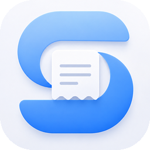

# SIMHub Downloads

[日本語](README.ja.md) · [Русский](README.ru.md)

SIMHub manages physical SIM and eSIM cards on iPhone, iPad, Mac, and Android. With a compatible reader, it can manage profiles on a removable eSIM card and use that card for Wi-Fi Calling, SMS, and calls.

> SIMHub has been unavailable on the App Store since 7 October 2026 while an appeal is in progress. Existing installations continue to work. This repository distributes installation packages only; it does not contain application source code.

## Downloads

Download packages from [Releases](../../releases).

| Platform | Version | File | Requirement | Notes |
| --- | --- | --- | --- | --- |
| iOS / iPadOS | **29.3 (1)** | `SIMHub-29.3.ipa` | iOS / iPadOS 17+ | Re-sign with your own Apple ID. Recommended for free Apple IDs. |
| iOS / iPadOS, widgets | 29.3 (1) | `SIMHub-29.3-widgets.ipa` | iOS / iPadOS 17+ | Requires a paid Apple Developer account. |
| iOS / iPadOS, legacy | SIMKit 7.0 (1) | `SIMKit.ipa` | iOS / iPadOS 15+ | iOS 15/16-compatible edition. |
| macOS | 29.22 (3) | `SIMHub-macOS-29.22.zip` | macOS 14+ | Notarized by Apple. |
| Android | **23.0 (1)** | `SIMHub-Android-23.0.apk` | Android 8+ | [Community-signed APK](../../releases/tag/android-v23.0). |

## Installation

### iOS and iPadOS

Download `SIMHub-29.3.ipa`, re-sign it with your own Apple ID, then install it. [AltStore](https://altstore.io), [Sideloadly](https://sideloadly.io), and other local signing tools can be used.

- A free Apple ID signature expires after seven days. Refresh it with the same tool; app data stays on the device.
- The standard IPA omits iCloud sync, push notifications, widgets, and password AutoFill so it can be signed by a free Apple ID. Core reader, eSIM, Wi-Fi Calling, SMS, call, and card-ledger features remain available.
- If the App Store build is installed, export a backup and remove it before installing a differently signed build. Import the backup afterwards.
- “Unable to verify app integrity” means the IPA was not re-signed. Copying an IPA directly to a phone is not enough.

### macOS

Unzip `SIMHub-macOS-29.22.zip`, move `SIMHub.app` to Applications, and open it. No re-signing is required. macOS supports USB readers, 4G modules, and relaying a reader or module to an iPhone over the local network or Tailscale.

### Android

Open `SIMHub-Android-23.0.apk` on the device and allow the browser or file manager to install unknown apps when Android asks. No re-signing is required.

- Supports USB CCID readers (with USB OTG) and compatible Bluetooth card readers.
- Supports Wi-Fi Calling, SMS, calls, card records, subscription tracking, and reminders.
- This community-signed APK cannot update a build signed with a different certificate. Export an in-app backup, uninstall the other build, install this APK, then import the backup.
- Emergency calling is not supported. Calls to mainland China (+86) are blocked.

## Main features

- **eSIM management through readers:** read EID and ICCID; enable, disable, delete, and download profiles; support for compatible 5ber, Xesim, eSTK, 9eSIM, multi-chip cards, and SIM PIN.
- **Wi-Fi Calling:** use a reader card for SMS and calls through IKEv2/IPsec, EAP-AKA, and IMS, with carrier-specific settings.
- **4G modules and Mac/NAS relay:** use an external module as a card source or share a reader/module over a local network or Tailscale.
- **Card ledger:** track subscriptions, usage, billing, and expiry reminders; calendar integration and widgets are available where supported.

## Data, safety, and terms

Data remains on the device and, where enabled, in the user's own iCloud account. SIMHub does not use a third-party SIMHub server. Export an in-app backup before changing devices, reinstalling, or changing Android signing channels; iOS and Android backups are compatible.

Use SIMHub only with SIM cards and numbers that you legally own or are authorized to manage. The app does not read, export, or upload SIM secret keys; card authentication remains on the card. Do not use it for fraud, impersonation, harassment, spam, bulk registration, unauthorized access, or to evade carrier, identity-verification, billing, or regulatory requirements.

The software is provided “as is”, without warranty. You are responsible for complying with applicable law and carrier terms. SIMHub is independent and is not affiliated with any carrier, eSIM provider, or card-reader manufacturer.

## License

Copyright © 2025–2026 the SIMHub developer. All rights reserved.

SIMHub and SIMKit are proprietary software, not open source. You receive a personal, non-exclusive, non-transferable, revocable license to use them on devices you own for lawful personal learning, research, and management of SIM/eSIM cards you are entitled to manage. Without written permission, you may not reverse engineer, modify, translate, adapt, create derivative works from, redistribute, sell, rent, lend, commercially use, remove branding from, or re-sign and republish the software. Third-party components remain subject to their own licenses.
