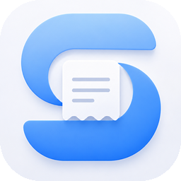

# Загрузки SIMHub

[English](README.md) · [日本語](README.ja.md)

SIMHub — приложение для управления физическими SIM- и eSIM-картами на iPhone, iPad, Mac и Android. С совместимым считывателем оно управляет профилями на съёмной eSIM-карте и позволяет использовать эту карту для Wi‑Fi Calling, SMS и звонков.

> SIMHub недоступен в App Store с 7 октября 2026 года, пока рассматривается апелляция. Уже установленные приложения продолжают работать. В этом репозитории находятся только установочные пакеты; исходный код приложения не публикуется.

## Загрузки

Скачивайте пакеты на странице [Releases](../../releases).

| Платформа | Версия | Файл | Требование | Примечание |
| --- | --- | --- | --- | --- |
| iOS / iPadOS | **29.3 (1)** | `SIMHub-29.3.ipa` | iOS / iPadOS 17+ | Перед установкой подпишите пакет своим Apple ID. |
| iOS / iPadOS, виджеты | 29.3 (1) | `SIMHub-29.3-widgets.ipa` | iOS / iPadOS 17+ | Для платной учётной записи Apple Developer. |
| iOS / iPadOS, старые системы | SIMKit 7.0 (1) | `SIMKit.ipa` | iOS / iPadOS 15+ | Версия для iOS 15 / 16. |
| macOS | 29.22 (3) | `SIMHub-macOS-29.22.zip` | macOS 14+ | Нотаризировано Apple. |
| Android | **23.0 (1)** | `SIMHub-Android-23.0.apk` | Android 8+ | [APK с подписью сообщества](../../releases/tag/android-v23.0). |

## Установка

### iOS и iPadOS

Скачайте `SIMHub-29.3.ipa`, подпишите его своим Apple ID и затем установите. Подходят [AltStore](https://altstore.io), [Sideloadly](https://sideloadly.io) и другие локальные средства подписи.

- Подпись бесплатного Apple ID действует семь дней. Обновляйте её тем же инструментом; данные приложения остаются на устройстве.
- В стандартном IPA нет синхронизации iCloud, push-уведомлений, виджетов и автозаполнения паролей, чтобы его можно было подписать бесплатным Apple ID. Основные функции считывателя, eSIM, Wi‑Fi Calling, SMS, звонков и учёта карт доступны.
- Если установлена версия из App Store, сначала экспортируйте резервную копию и удалите её, затем установите версию с другой подписью и импортируйте резервную копию.
- Сообщение о невозможности проверить целостность означает, что IPA не был повторно подписан.

### macOS

Скачайте и распакуйте `SIMHub-macOS-29.22.zip`, перенесите `SIMHub.app` в Applications и откройте его. Повторная подпись не требуется. Поддерживаются USB-считыватели, 4G-модули и передача считывателя или модуля на iPhone через локальную сеть либо Tailscale.

### Android

Откройте `SIMHub-Android-23.0.apk` на Android-устройстве и, когда Android попросит, разрешите браузеру или файловому менеджеру устанавливать неизвестные приложения. Повторная подпись не требуется.

- Поддерживаются USB CCID-считыватели через USB OTG и совместимые Bluetooth-считыватели карт.
- Поддерживаются Wi‑Fi Calling, SMS, звонки, учёт карт, отслеживание подписок и напоминания.
- Этот APK с подписью сообщества не может обновить сборку, подписанную другим сертификатом. Сначала экспортируйте резервную копию, удалите другую сборку, установите этот APK и импортируйте резервную копию.
- Экстренные вызовы не поддерживаются. Звонки на номера материкового Китая (+86) заблокированы.

## Основные возможности

- **Управление eSIM через считыватели:** чтение EID и ICCID, включение, отключение, удаление и загрузка профилей; поддержка совместимых 5ber, Xesim, eSTK, 9eSIM, многочиповых карт и SIM PIN.
- **Wi‑Fi Calling:** SMS и звонки с карты в считывателе через IKEv2/IPsec, EAP-AKA и IMS с настройками для операторов.
- **4G-модули и ретрансляция Mac/NAS:** используйте внешний модуль как источник карты или предоставляйте считыватель/модуль по локальной сети либо Tailscale.
- **Учёт карт:** подписки, трафик, счета и напоминания об окончании срока; там, где доступно, есть интеграция с календарём и виджеты.

## Данные, безопасность и условия

Данные хранятся на устройстве и, если включено, в собственной учётной записи iCloud пользователя. Сервер SIMHub третьих сторон не используется. Перед сменой устройства, переустановкой или сменой канала подписи Android экспортируйте резервную копию; резервные копии iOS и Android совместимы.

Используйте SIMHub только с SIM-картами и номерами, которыми вы законно владеете или которыми уполномочены управлять. Приложение не считывает, не экспортирует и не загружает секретные ключи SIM. Запрещено использовать программу для мошенничества, выдачи себя за другое лицо, преследования, спама, массовой регистрации, несанкционированного доступа к чужой карте или номеру, а также для обхода требований оператора, идентификации, тарификации или регулирования.

Программное обеспечение предоставляется «как есть», без каких-либо гарантий. Вы несёте ответственность за соблюдение законодательства и условий оператора. SIMHub независим и не связан с операторами, поставщиками eSIM или производителями считывателей.

## Лицензия

Copyright © 2025–2026 the SIMHub developer. All rights reserved.

SIMHub и SIMKit являются проприетарным, а не открытым программным обеспечением. Вам предоставляется личная, неисключительная, непередаваемая, отзывная лицензия на установку и использование программы на принадлежащих вам устройствах для законного личного обучения, исследований и управления SIM/eSIM, которыми вы вправе управлять. Без письменного разрешения запрещены обратная разработка, модификация, перевод, адаптация, создание производных работ, распространение, продажа, аренда, передача, коммерческое использование, удаление обозначений авторских прав или бренда, а также повторная подпись и публикация под другим именем. На сторонние компоненты распространяются их собственные лицензии.
